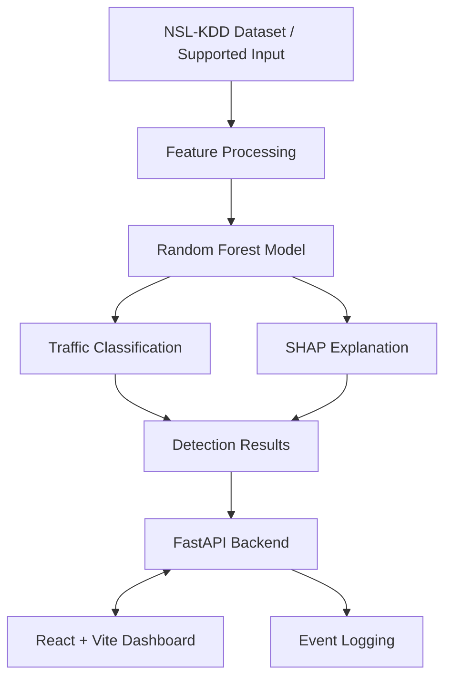

# ⚡ SentraX
### Explainable AI Intrusion Detection System

**See the threat. Understand the reason. Investigate with confidence.**

SentraX is an AI-powered intrusion detection project designed to classify network traffic and make model predictions easier to understand. It combines machine learning, SHAP-based explainability, a FastAPI backend, and an interactive web dashboard in one security-focused interface.

<p align="center">
  <strong>AI Detection · Explainable Predictions · Security Analytics</strong>
</p>

---

## 🛡️ The Mission

Detection alone isn't enough. Security analysts also need to understand *why* traffic is considered suspicious.

SentraX explores that problem by combining a Random Forest classifier trained on the **NSL-KDD dataset** with explainability techniques that help interpret its predictions.

The goal: make machine learning-based intrusion detection more transparent and easier to investigate.

## ✨ Core Capabilities

<table>
  <tr>
    <td width="50%">
      <h3>🧠 AI-Powered Detection</h3>
      Classifies supported traffic records using a Random Forest machine learning model.
    </td>
    <td width="50%">
      <h3>🔎 Explainable AI</h3>
      Uses SHAP to help explain which input features influence model predictions.
    </td>
  </tr>
  <tr>
    <td width="50%">
      <h3>📊 Interactive Dashboard</h3>
      Provides a visual interface for exploring detection results and security information.
    </td>
    <td width="50%">
      <h3>⚠️ Risk-Oriented Analysis</h3>
      Includes risk analysis and event logging components for security investigation workflows.
    </td>
  </tr>
  <tr>
    <td width="50%">
      <h3>🧪 Traffic Demonstration Tools</h3>
      Includes scripts for demonstrating and testing selected detection workflows.
    </td>
    <td width="50%">
      <h3>🔌 API-Driven Design</h3>
      Uses FastAPI to connect backend detection functionality with the frontend.
    </td>
  </tr>
</table>

## 🏗️ System Architecture



<sub>Conceptual architecture — confirm the actual data flow against the implementation before using it as a definitive system diagram.</sub>

## ⚙️ Technology Stack

| Layer | Technologies |
|---|---|
| Frontend | React, Vite |
| Backend | Python, FastAPI |
| Machine Learning | Scikit-learn, Random Forest |
| Explainability | SHAP |
| Data Processing | Pandas, NumPy |
| Visualization | Recharts, Matplotlib |
| Dataset | NSL-KDD |

## 🚀 Get Started

### Requirements

- Python 3
- Node.js and npm
- Git

### 1. Clone the repository

```bash
git clone https://github.com/gautamkumar-exe/SentraX-Explainable-AI-IDS.git
cd SentraX-Explainable-AI-IDS
```

### 2. Set up the backend

Create a virtual environment:

```bash
python3 -m venv .venv
source .venv/bin/activate
```

Install the project dependencies:

```bash
pip install -r requirements.txt
```

If FastAPI or Uvicorn is missing from the requirements, install them:

```bash
pip install fastapi "uvicorn[standard]"
```

### 3. Install frontend dependencies

```bash
cd frontend
npm install
cd ..
```

### 4. Launch SentraX

```bash
chmod +x start.sh
./start.sh
```

When the services start successfully, open the local dashboard and API:

| Service | Address |
|---|---|
| Web dashboard | [localhost:5173](http://localhost:5173) |
| Backend API | [localhost:8000](http://localhost:8000) |
| API documentation | [localhost:8000/docs](http://localhost:8000/docs) |

These are the expected local addresses; actual availability depends on successful startup and project configuration.

## 🧬 Detection Workflow

1. **Input:** Prepare a supported network traffic record or dataset sample.
2. **Processing:** Prepare the features required by the model.
3. **Inference:** Run the Random Forest classifier.
4. **Explanation:** Use SHAP to help interpret the prediction.
5. **Presentation:** Expose detection results through the backend and dashboard.
6. **Review:** Inspect available risk information and event logs.

Refer to `train.py`, `model.py`, and `api.py` for implementation details.

## 📁 Project Structure

```text
SentraX/
├── frontend/          # React + Vite dashboard
├── model/             # Model-related assets
├── api.py             # FastAPI application
├── app.py             # Application entry point
├── model.py           # Model-related logic
├── train.py           # Training workflow
├── sniffer.py         # Traffic monitoring functionality
├── attack_drill.py    # Demonstration/testing workflow
├── demo_injector.py   # Demo event injection
├── requirements.txt   # Python dependencies
├── start.sh           # Startup script
└── README.md
```

## 🔐 Responsible Use

SentraX is a cybersecurity learning and demonstration project. Use traffic capture, testing, and simulation tools only on systems and networks you own or have explicit authorization to assess.

Machine learning predictions are not definitive proof of an intrusion. False positives and false negatives are possible, so results require appropriate validation before operational use.

## 🗺️ Roadmap

- [ ] Expand model evaluation and false-positive analysis.
- [ ] Test generalization across additional datasets.
- [ ] Improve investigation and filtering workflows.
- [ ] Add automated testing and reproducible setup checks.
- [ ] Evaluate secure deployment and authentication options.

## 👨‍💻 Author

**Gautam Kumar**

GitHub: [@gautamkumar-exe](https://github.com/gautamkumar-exe)

---

<p align="center">
  <strong>SentraX — Making AI-Based Intrusion Detection More Explainable.</strong>
</p>
